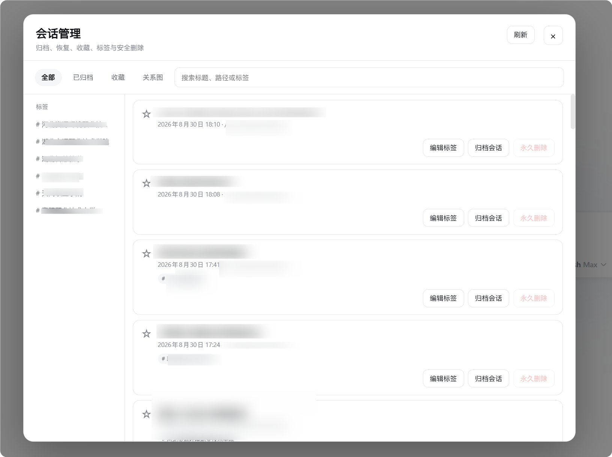
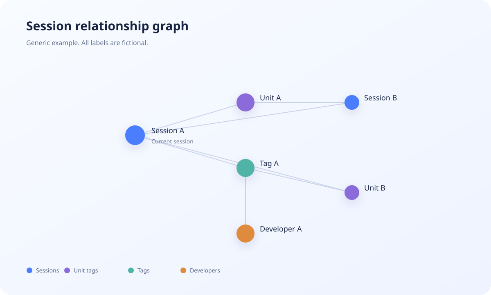
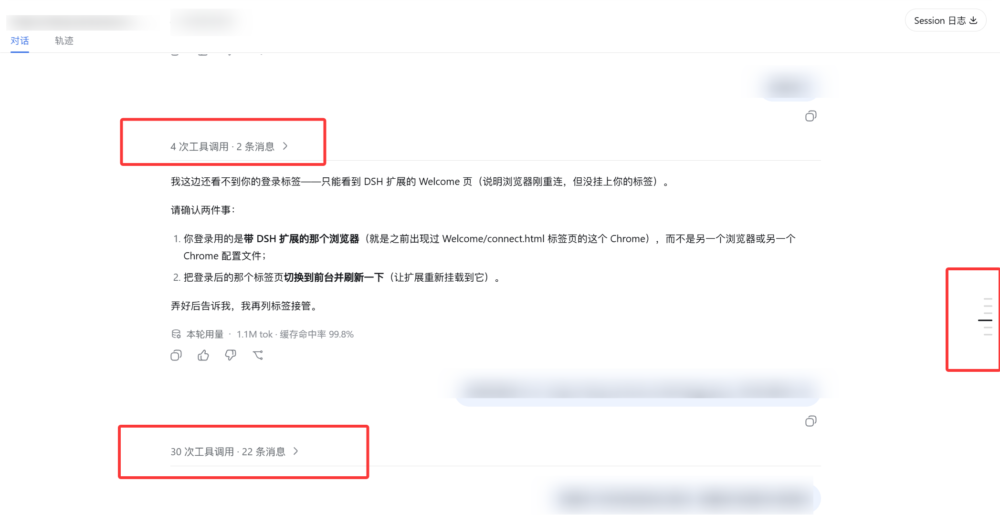

<div align="center">

# DSH Session Manager

面向 DeepSeek Harness Web 的会话治理插件：以目标单位标签组织 Session，复用官方归档与置顶能力，并让长对话折叠与轮次跳转保持完整。

[](https://github.com/6jeffr3y/dsh-session-manager/actions/workflows/ci.yml)
[](https://github.com/6jeffr3y/dsh-session-manager/releases)
[](LICENSE)
[](https://nodejs.org/)
[](https://github.com/topics/dsh-plugin)

</div>

## 核心优势

- **官方会话能力复用**：归档、取消归档和置顶直接调用 DSH 官方 Workspace 服务，插件只补充目标单位标签、普通标签、筛选与删除流程。
- **目标关系感知**：会话可记录目标单位标签、开发商和普通标签；关系图按相同目标单位标签或开发商连接会话，普通标签作为独立普通节点展示。
- **受控交叉查看**：模型可通过 `session_related` 找到同目标会话，并用 `session_reports` 只读取对方工作目录中的受限 Markdown 报告/线索，不读完整会话日志。
- **多目标单位标签组织**：为一个 Session 添加多个目标单位标签，复用已有目标单位标签，并按标题、路径或目标单位标签检索。
- **层级化关系图**：目标单位标签和开发商使用特殊节点，普通标签使用独立颜色；归档会话不进入图谱，避免无依据的关系推断。
- **主页面会话管理**：默认在右侧主内容区打开会话管理页面；标题栏的“缩为窗口”可切换为紧凑模态，标签通过下拉选择和可移除芯片编辑。
- **安全删除**：永久删除要求会话已经归档、停止运行并完成二次确认；仅清理 Session 内容和关联投影，不删除 MemOS、Agent 记忆、Skill 或模型配置。
- **完整长对话导航**：补全当前 Session 的历史窗口，使 DSH 原生 Compact 过程折叠、用户输入轮次标记和右侧 Turn Rail 基于完整轮次渲染。

## 界面预览

### 会话归档与目标单位标签管理

集中管理目标单位标签、普通标签、置顶和归档状态。点击会话标题可直接跳转；归档、取消归档和置顶沿用 DSH 官方语义，符合删除条件后才能永久删除。

<p align="center">
  
</p>

### 目标单位标签关系图

目标单位标签、开发商和普通标签连接对应的未归档会话。图谱支持滚轮和按钮缩放、拖动画布以及点击节点筛选；概览状态隐藏会话文字，放大后显示，悬停时聚焦相邻节点。

<p align="center">
  
</p>

### 长对话折叠与轮次导航

插件通过 DSH 公开的 `Session.loadOlder()` 串行加载当前会话的更早历史页。完整历史窗口让原生“工具调用 · 消息”过程区块稳定折叠，并使右侧用户输入轮次标记能够定位到对应输入。

<p align="center">
  
</p>

## 安装

要求已经安装 DeepSeek Harness，并使用 Node.js `^22.19.0 || >=24`。

```sh
dsh plugin --profile web add github:6jeffr3y/dsh-session-manager#v0.1.3
```

重启 Web profile 后生效：

```sh
dsh web
```

卸载插件：

```sh
dsh plugin --profile web remove dsh-plugin-session-manager
```

> GitHub 安装直接使用 Release 中提交的 `lib/`，不执行安装期构建脚本。需要固定供应链内容时，可以把版本标签替换为具体 commit SHA。

## 配置

默认配置位于 `cordis.patch.yml`：

| 配置项 | 默认值 | 说明 |
| --- | --- | --- |
| `stateDir` | `''` | 插件状态目录；空值使用 `$DSH_HOME/session-manager` |
| `autoLoadFullHistory` | `true` | 自动加载当前会话的更早历史页 |
| `reportRoots` | `['reports', 'analysis', 'notes']` | `session_reports` 优先读取的目录 |
| `reportMaxFiles` | `5` | 单次最多读取的 Markdown 文件数 |
| `reportMaxCharsPerFile` | `4000` | 单个文件最多返回的字符数 |
| `reportMaxTotalChars` | `12000` | 单次返回的总字符上限 |

## 数据与删除范围

永久删除仅支持已经归档、当前未运行且使用独立 JSONL 制品的 Session。仍由 Host 挂载但已经停止的会话会进入待删除队列，并在下次 DSH 启动、恢复该会话之前完成删除。正在生成回复的会话会被明确拒绝删除。

删除范围包括 Session JSONL、对应的投影缓存、Workspace 成员关系、官方归档状态以及本插件保存的目标单位标签、普通标签和元数据。插件不会删除：

- MemOS 数据库或 `~/.dsh/memos-plugin/`
- Agent 记忆与 Skill
- 其他 Session
- 插件与模型配置
- 跨 Session 共享的附件对象

## 兼容性

当前版本针对 DeepSeek Harness `0.2.2-alpha.3` 开发和测试。DSH 仍处于预发布阶段；Workspace 或 Session 内部接口发生变化时，本插件会明确失败，不直接修改未知格式的数据。

## 本地开发

```sh
git clone https://github.com/6jeffr3y/dsh-session-manager.git
cd dsh-session-manager
npm install --ignore-scripts
npm run check
npm run pack:check
```

安装本地 checkout：

```sh
dsh plugin --profile web add link:$PWD
```

## License

[MIT](LICENSE)

## DSH 0.2.2-alpha.3 兼容性

归档、取消归档和置顶使用 `workspaceRegistry.archiveSession()`、`unarchiveSession()` 和 `pinSession()` / `unpinSession()`。会话元数据使用 `sessionPersistence.list({ signal })` 返回的 snapshot.header，单会话存在性检查使用 `stat()`。永久删除优先使用 snapshot 的 `location.path` 定位所选 generation，并在缺少该字段时回退到 JSONL 后端公开的 `resolveCurrentLog()`；支持 `session.jsonl[.zstd]` 和 `session.vN.jsonl[.zstd]`，历史 generation 可直接删除，无需先打开会话完成迁移。仍保留精确 ID 二次确认、先归档和运行态拒绝；插件不为删除操作创建或重写 Session 日志。

标题生成完全使用 DSH 官方 `session-title` provider；插件不再拦截或改写 `llm/stream` 请求。

## 模型工具

- `session_tag`：为当前或其他会话添加/移除目标单位标签、开发商和普通标签。
- `session_related`：按目标单位标签或开发商查找关联会话，只返回摘要。
- `session_reports`：读取关联会话工作目录中的 `reports/`、`analysis/`、`notes/` 和根目录 Markdown；默认限制 5 个文件、单文件 4000 字符、总计 12000 字符。

`session_reports` 不读取 Session 日志，并且只接受与调用方存在目标单位标签或开发商关系的会话。
